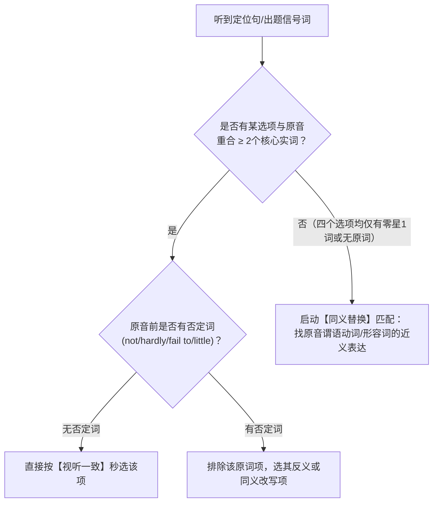

# 概念卡：视听一致与同义替换平衡术 (Audio-Visual Consistency vs. Paraphrase)

## 1. 核心定义
在六级听力中，“视听一致（听到什么选什么）”与“同义替换（听到A选A的近义词B）”并非相互冲突，而是**按题型与出题位置分层作用**的双重机制。

---

## 2. 考场判定决策树

---

## 3. 关联节点
- 实战手册：[听力视听一致与同义替换法则](../../01-projects/听力/听力视听一致与同义替换法则.md)
- 词库支撑：[六级高频核心词与同义替换总表](../../02-areas/vocabulary/六级高频核心词与同义替换总表.md)
